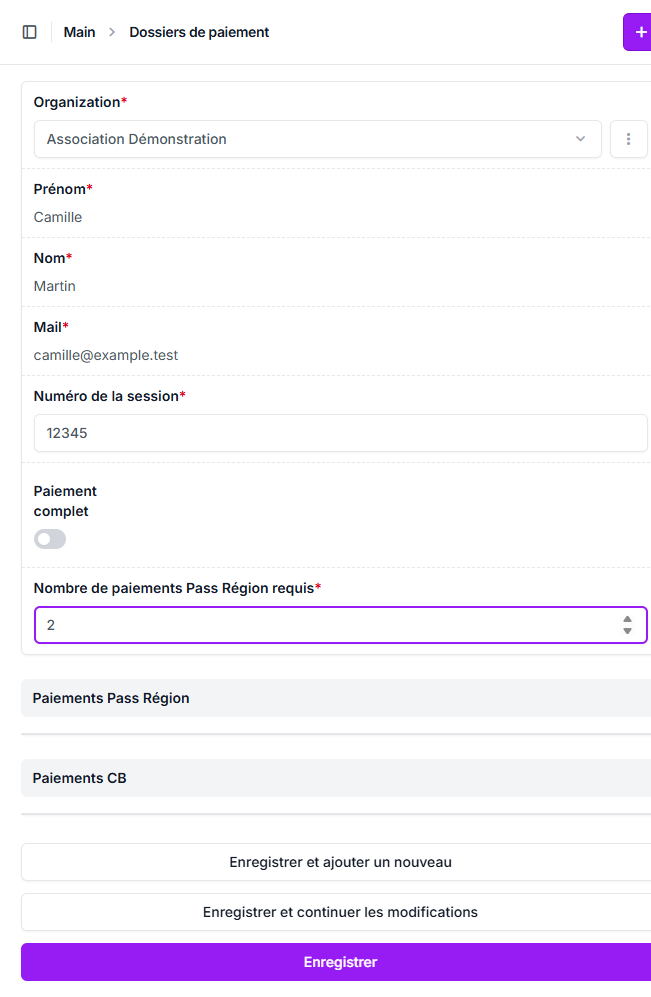
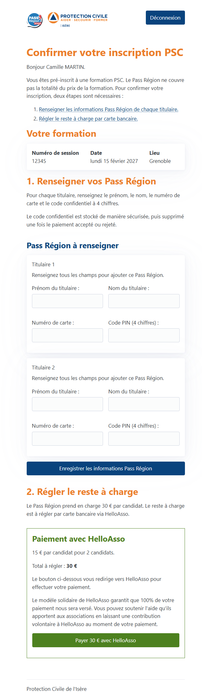
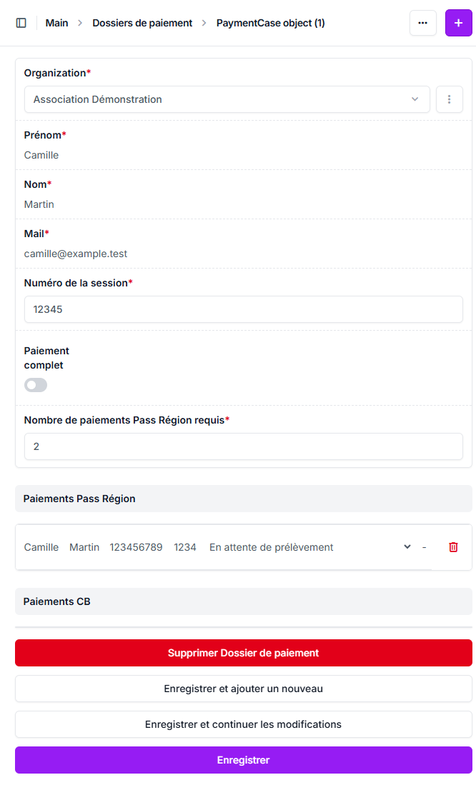
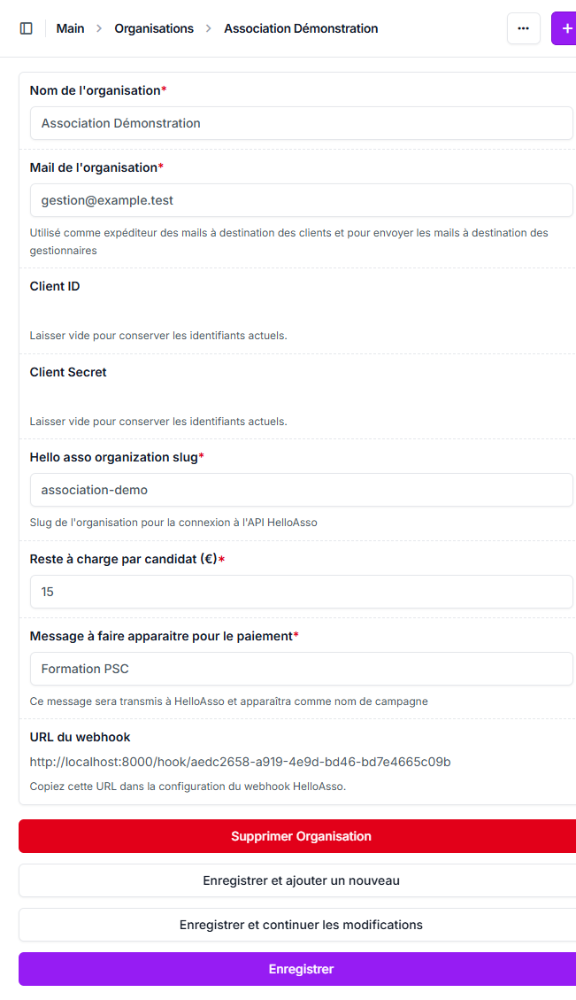

# Guide des gestionnaires — paiement avec le Pass Région

Ce guide décrit le suivi d'une pré-inscription à une formation PSC lorsque le client utilise un ou plusieurs Pass Région et règle le reste par carte bancaire.

Les captures présentent un environnement de démonstration : noms, coordonnées, numéros et montants sont fictifs. L'apparence et les menus peuvent varier selon vos droits ; certaines captures sont antérieures à l'ajout de la recherche et des filtres.

## Avant de commencer

Il vous faut un compte de gestionnaire, l'adresse de l'interface d'administration et les droits sur votre organisation. Si un menu ou un dossier n'est pas accessible, contactez la personne qui administre l'outil.

Pour chaque dossier, préparez :

- le prénom, le nom et l'adresse électronique de la personne qui recevra le lien ;
- le numéro de la session de formation ;
- le nombre de Pass Région attendus, normalement un par candidat ;
- l'organisation chargée du dossier.

Le client renseigne lui-même les informations de chaque Pass Région. Ne lui demandez pas de vous envoyer son code confidentiel par courrier électronique.

## 1. Créer le dossier

1. Connectez-vous à l'interface d'administration.
2. Ouvrez **Dossiers de paiement**, puis choisissez l'option d'ajout (**+** ou **Ajouter**).
3. Sélectionnez votre **organisation** et renseignez le **prénom**, le **nom**, le **mail** et le **numéro de la session**.
4. Indiquez le **nombre de paiements Pass Région requis**. Par exemple, saisissez `2` pour deux candidats utilisant chacun leur Pass Région.
5. Laissez **Paiement complet** décoché : cette case sert au suivi lorsque les paiements ont été vérifiés.
6. Cliquez sur **Enregistrer**.

À l'enregistrement, l'outil envoie au client un courriel contenant un lien personnel vers son dossier. Vérifiez l'adresse avant de créer le dossier : c'est à cette adresse que le lien sera envoyé. Si le client ne reçoit rien, demandez-lui de vérifier ses courriers indésirables, puis contactez l'administrateur de l'outil si nécessaire.

## 2. Ce que voit et fait le client

Le client ouvre le lien reçu par courriel. Il arrive sur une page qui présente le numéro de session, la date et le lieu lorsqu'ils sont disponibles, puis les deux étapes :

1. Pour chaque titulaire, saisir son prénom, son nom, son numéro de carte et son code confidentiel à quatre chiffres, puis cliquer sur **Enregistrer les informations Pass Région**. Il peut revenir compléter les Pass manquants.
2. Cliquer sur le bouton de paiement pour être redirigé vers **HelloAsso** et régler le reste à charge. Le montant affiché correspond au reste à charge par candidat multiplié par le nombre de Pass Région requis. Le client renseigne ses coordonnées sur HelloAsso, puis poursuit vers le formulaire bancaire.

HelloAsso peut ajouter une contribution volontaire au montant proposé. Le client peut la modifier, y compris la mettre à zéro, avant de payer. C'est le client qui vérifie le total sur HelloAsso : par exemple, pour deux candidats avec un reste à charge de 30 € chacun, le total est de 60 € plus la contribution qu'il a choisie.

Le client peut consulter sur cette page les Pass enregistrés et leur statut. Après un rejet, un nouveau formulaire est proposé pour saisir un Pass de remplacement. Le code confidentiel n'est pas affiché au client après l'enregistrement ; il est supprimé de l'outil lorsque le prélèvement est marqué comme accepté ou rejeté.

Après un retour de paiement bancaire annoncé comme réussi, la page peut indiquer que le paiement est **en attente de vérification**. Attendez la confirmation effective avant de le considérer comme payé. Si le paiement échoue, le client peut réessayer depuis sa page.

## 3. Suivre et traiter les paiements

### Retrouver les dossiers

Ouvrez **Dossiers de paiement** :

- Utilisez la barre **Type to search** pour chercher un prénom, un nom, une adresse mail ou un numéro de session, puis appuyez sur **Entrée** ou cliquez sur la loupe. La recherche accepte des fragments et plusieurs mots, par exemple un prénom et une partie du nom.
- Ouvrez **Filters** pour sélectionner un **Numéro de la session** et/ou **Paiement complet** : **Oui**, **Non** ou **Tout**.
- Les filtres se combinent entre eux et avec la recherche. Par exemple, sélectionnez une session et **Paiement complet : Non** pour retrouver les dossiers de cette formation restant à traiter.
- Pour retirer un filtre, choisissez **Tout** dans sa rubrique. Pour revenir à la liste complète, cliquez sur le lien indiquant le nombre total de résultats ; en l'absence de résultat, **Reset filters** efface la recherche et les filtres.

La liste affiche notamment la session, les coordonnées du client, l'état **Paiement complet** et **Pass Région acceptés / attendus**. Ce compteur ne compte que les Pass marqués **Prélèvement accepté**, pas les Pass rejetés ou en attente.

### Traiter un dossier

1. Retrouvez le dossier dans la liste et ouvrez-le.
2. Dans **Paiements Pass Région**, consultez les informations reçues et le statut de chaque Pass. Le code confidentiel est visible dans cette interface tant que le paiement n'est pas accepté ou rejeté : limitez l'accès au dossier aux personnes habilitées et ne partagez pas de capture contenant des données réelles.
3. Effectuez le prélèvement Pass Région selon votre procédure habituelle, en dehors de cet outil. L'enregistrement de la carte par le client ne signifie pas que le prélèvement a été effectué.
4. Après le résultat du prélèvement, choisissez **Prélèvement accepté** ou **Prélèvement rejeté** sur la ligne correspondante, puis cliquez sur **Enregistrer**. Ne choisissez ces statuts qu'après vérification : l'enregistrement supprime le code confidentiel.
5. Vérifiez aussi la partie **Paiements CB** du dossier ou le menu **Paiements CB**. Le statut **Paiement confirmé** indique que la confirmation HelloAsso a été reçue. **En attente de paiement**, **En attente de confirmation du paiement** et **Paiement échoué** ne sont pas des confirmations.
6. Lorsque tous les Pass attendus ont été prélevés avec succès et que le paiement bancaire est confirmé, cochez **Paiement complet**, puis enregistrez. Cette case est un repère de suivi manuel ; elle ne se coche pas automatiquement.

Par exemple, un dossier avec un Pass accepté, un Pass rejeté et son remplacement en attente affiche **1 / 2**, même si trois Pass figurent dans l'historique. Lorsque le remplacement est accepté, le compteur passe à **2 / 2**. Ce compteur concerne uniquement les Pass Région : il ne confirme pas le paiement bancaire et ne coche pas **Paiement complet**.

En cas de rejet, prévenez le client selon votre procédure et invitez-le à revenir sur sa page pour saisir un Pass de remplacement. Le Pass rejeté reste visible dans l'historique.

La date du paiement Pass Région apparaît dans le dossier, mais elle n'est pas modifiable depuis cette page. De même, ne déduisez pas qu'une date absente signifie que le prélèvement n'a pas eu lieu.

## Corriger les coordonnées du client

Ouvrez le dossier, modifiez le **prénom**, le **nom** et/ou le **mail**, puis cliquez sur **Enregistrer**.

- Les nouvelles coordonnées sont conservées.
- Si l'adresse mail change, un courriel contenant le lien personnel est automatiquement envoyé à la nouvelle adresse.
- Une modification du prénom ou du nom seule ne déclenche pas cet envoi.

Vérifiez la nouvelle adresse avant d'enregistrer. Si l'adresse est correcte mais que le client ne retrouve pas son courriel, demandez-lui de vérifier les courriers indésirables, puis contactez l'administrateur : il n'y a pas de bouton dédié pour renvoyer le lien sans changer l'adresse.

## Courriels et notifications

| Quand ? | Destinataire | Contenu |
| --- | --- | --- |
| À la création du dossier | Client, à l'adresse indiquée dans le dossier | Objet « [Protection Civile] Inscription avec le Pass Région » ; mention de la formation PSC, date si disponible, indication qu'un reste à charge est à payer et lien personnel vers la page de paiement. |
| Lors d'un changement d'adresse mail dans le dossier | Client, à la nouvelle adresse | Même courriel d'inscription, avec le lien personnel vers la page de paiement. |
| Lors de l'enregistrement d'un Pass Région | Adresse électronique de l'organisation | Objet « [Protection Civile] Enregistrement d'un Pass Région » ; annonce d'un nouveau Pass et lien vers le dossier. Un message est envoyé pour chaque Pass enregistré. |
| À la réception d'une confirmation de paiement bancaire HelloAsso | Adresse électronique de l'organisation | Objet « [Protection Civile] Confirmation d'un paiement par carte de crédit » ; annonce de la confirmation et lien vers le dossier. |

Les messages destinés aux gestionnaires ne détaillent pas le nom du client, le montant ou les données de carte : ouvrez le dossier pour vérifier les informations. L'adresse de l'organisation est également utilisée comme adresse de réponse aux courriels ; l'adresse d'expédition affichée peut être différente.

L'outil n'envoie actuellement pas de courriel automatique au client pour confirmer la fin du dossier, annoncer un rejet Pass Région ou le relancer. Cocher **Paiement complet** n'envoie pas de confirmation ni de convocation. Utilisez vos procédures habituelles pour informer le client et assurer la suite de son inscription.

## Modifier les paramètres de l'organisation

Si vos droits le permettent, ouvrez **Organisations**, sélectionnez votre organisation, modifiez les champs nécessaires puis cliquez sur **Enregistrer**.

| Paramètre | Pourquoi le modifier ? |
| --- | --- |
| **Nom de l'organisation** | Pour identifier correctement votre structure dans l'administration. |
| **Mail de l'organisation** | Pour recevoir les notifications de Pass enregistré et de paiement bancaire confirmé, et permettre aux clients de répondre à cette adresse. Utilisez une boîte consultée par les gestionnaires concernés. |
| **Reste à charge par candidat (€)** | Pour adapter le montant demandé à chaque candidat. Le total présenté au client est ce montant multiplié par le nombre de Pass requis dans le dossier. La modification concerne aussi les dossiers existants : vérifiez son impact avant de l'enregistrer, notamment si un paiement a déjà été commencé. |
| **Message à faire apparaître pour le paiement** | Pour choisir le libellé transmis à HelloAsso et affiché comme nom de campagne, par exemple « Formation PSC ». |
| **Hello asso organization slug** | Pour identifier l'organisation auprès de HelloAsso. Ne le changez qu'en cas de changement de compte ou sur instruction de votre référent HelloAsso. |
| **Client ID** et **Client Secret** | Pour remplacer les identifiants de connexion HelloAsso. Laissez les deux champs vides pour conserver les identifiants actuels ; pour les remplacer, renseignez les deux ensemble. Ne les partagez pas dans un courriel ou une capture. |
| **URL du webhook** | Cette adresse est affichée pour être reportée dans la configuration HelloAsso : elle permet à l'outil de recevoir la confirmation des paiements. Faites appel au référent technique ou HelloAsso si elle doit être configurée ; elle ne se modifie pas dans ce formulaire. |

La création ou la suppression d'une organisation est réservée à l'administrateur principal. La disponibilité des autres modifications dépend de vos droits.

## Sessions et difficultés courantes

- **Date ou lieu non communiqué au client** : la session peut ne pas avoir pu être renseignée automatiquement. Si vous avez accès au menu **Sessions**, ouvrez la session et renseignez ou corrigez sa date et son adresse ; sinon, contactez l'administrateur. Une session déjà enregistrée n'est pas actualisée automatiquement.
- **Un Pass est rejeté** : enregistrez le statut de rejet, puis demandez au client de revenir sur sa page pour saisir un Pass de remplacement. Le code précédemment saisi est supprimé.
- **Un paiement bancaire reste en attente ou échoue** : vérifiez son statut dans le dossier et, si nécessaire, auprès de votre référent HelloAsso. Une annonce de réussite sur la page du client ne remplace pas la confirmation du paiement.
- **Un client ne reçoit pas son lien ou ses coordonnées doivent être corrigées** : vérifiez l'adresse dans le dossier et corrigez-la si nécessaire. Enregistrer un changement d'adresse déclenche automatiquement un nouvel envoi. Si l'adresse est déjà correcte, faites vérifier l'envoi par l'administrateur.
- **Un client signale que le formulaire bancaire HelloAsso reste en chargement** : transmettez son signalement à votre référent HelloAsso ou technique et vérifiez le statut du paiement dans le dossier. La seule redirection du client vers HelloAsso n'est pas une preuve de paiement.

Avant de demander des paiements réels, faites confirmer par le responsable de l'outil que la connexion HelloAsso et l'envoi des courriels sont bien configurés pour votre environnement.
